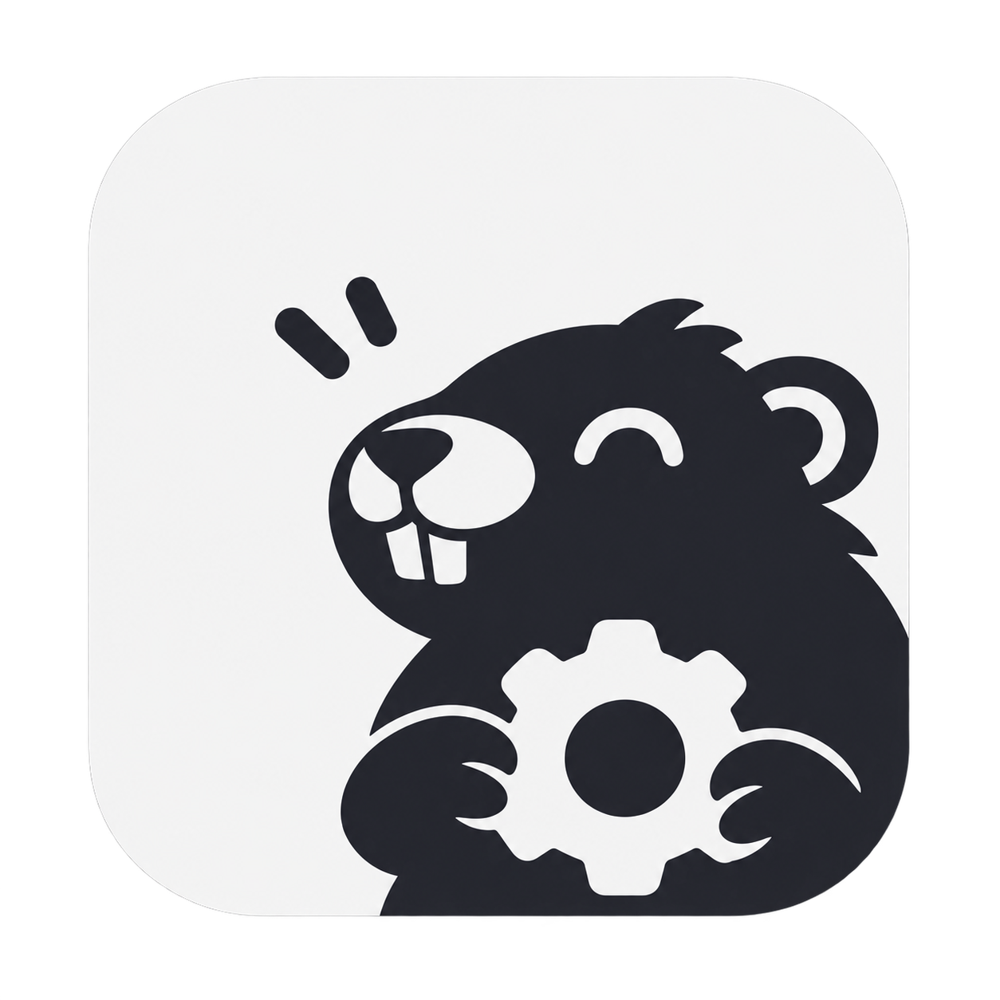
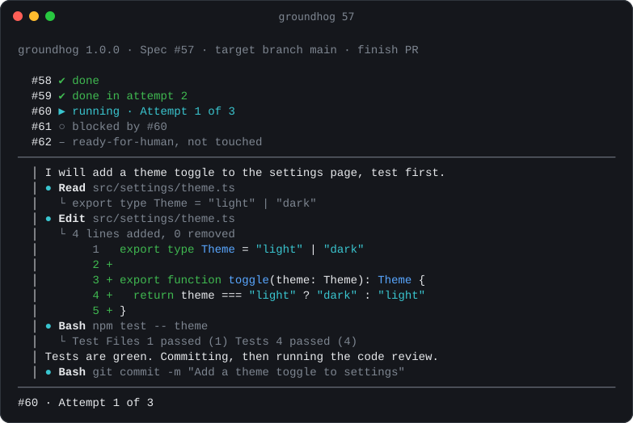
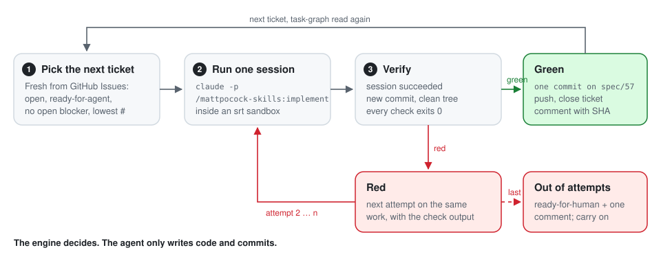
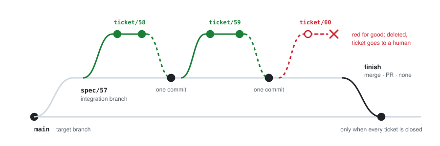

<p align="center">
  
</p>

<h1 align="center">groundhog</h1>

<p align="center">
  <b>Hand over a spec in the evening. Find every ticket done, or explained, in the morning.</b>
</p>

<p align="center">
  <a href="https://github.com/lucas-devries/groundhog/actions/workflows/checks.yml"></a>
  <a href="https://www.npmjs.com/package/groundhog-cli"></a>
  
  
  
  <a href="LICENSE"></a>
</p>

<p align="center">
  
</p>

groundhog is a local CLI that works through the tickets of a spec one by one, unattended. You give it the issue number of a spec. It answers a few questions up front, and then it runs [Claude Code](https://claude.com/claude-code) headless on one ticket after another.

Agents don't judge their own work here. **groundhog's engine is plain code with no LLM in it.** It picks the next ticket, checks the result itself and decides alone whether a ticket is done.

- **Deterministic:** the next ticket comes fresh from the tracker, never from the agent.
- **Verified:** a ticket counts as done only with a real commit, a clean tree and green checks.
- **Bounded:** each ticket gets a fixed number of attempts. Then it goes to a human with an explanation, and the run carries on.
- **Sandboxed:** every session and its checks run inside [`srt`](https://github.com/anthropics/sandbox-runtime). Your working directory is not writable, and only a fixed list of hosts is reachable.
- **Out of your way:** a run works in its own git worktree. You stay on your branch, keep your uncommitted changes and carry on in the same clone.
- **Readable history:** each ticket becomes exactly one commit on the spec's integration branch.

It builds on the [Matt Pocock skills](https://github.com/mattpocock/skills). After `/to-spec` and `/to-tickets` you have a spec with tickets in GitHub Issues, and groundhog takes it from there.

## How it works

<p align="center">
  <picture>
    <source media="(prefers-color-scheme: dark)" srcset="assets/readme/how-it-works-dark.svg">
    
  </picture>
</p>

1. **Pick.** groundhog reads the task graph from GitHub before every ticket. It takes the lowest-numbered ticket that is open, labelled `ready-for-agent`, has no open blocker and isn't claimed by someone else. It assigns that ticket to you.
2. **Session.** A fresh `claude -p "/mattpocock-skills:implement <ticket URL>"` runs on its own `ticket/<n>` branch, with a short AFK note: never ask back, test first, review, end with one commit.
3. **Verify.** groundhog checks every condition itself and shows each result: the session succeeded, `HEAD` is on the ticket branch, there is a new commit, the tree is clean, and every check in `groundhog.json` exits 0.
4. **Green.** The work lands on `spec/<n>` as one commit and gets pushed. The ticket is closed with a comment.
5. **Red.** The next attempt continues on the same work and gets the output of the failed check. After the last attempt the work is discarded. The ticket gets `ready-for-human` and one comment that explains every attempt, including the `claude --resume` command. Tickets that depend on it stay blocked on their own, and everything else goes on.

<p align="center">
  <picture>
    <source media="(prefers-color-scheme: dark)" srcset="assets/readme/branches-dark.svg">
    
  </picture>
</p>

The **finish** you chose at the start runs only once every ticket of the spec is closed: merge into the target branch, open a PR, or nothing. Until then the pushed integration branch just waits for the next run.

## Install

```sh
npm install -g groundhog-cli
```

You need:

| Requirement                                       | Version and notes                                                      |
| ------------------------------------------------- | ---------------------------------------------------------------------- |
| **Node.js**                                       | 24 or newer                                                            |
| **git**                                           | any recent version                                                     |
| **[gh](https://cli.github.com)**                  | 2.94 or newer, logged in (`gh auth login`)                             |
| **[Claude Code](https://claude.com/claude-code)** | `claude` on your `PATH`, logged in                                     |
| **Matt Pocock skills**                            | the Claude Code plugin; groundhog offers to install it if it's missing |
| **Linux only**                                    | `bubblewrap`, `socat` and `ripgrep` for the sandbox                    |

groundhog runs on macOS and Linux. With the sandbox on, it refuses to start as `root`.

## Quick start

**1. Set up the project, once.** In the root of your repo:

```sh
groundhog init
```

`init` asks for your checks, the target branches, extra hosts for the sandbox, and the number of attempts. In a Node project it suggests the checks. The only file it writes is `groundhog.json`. Then it asks whether to commit it now (default: Yes). On Yes, it makes a local commit on the current branch that contains only `groundhog.json`, and pushes nothing. On No, commit the file yourself before you start a run. If the file does not differ from the committed one, there is no question. If git refuses the commit, `init` shows its error and exits with `1`; Ctrl+C at this question exits with `130`. In both cases the file stays written.

**2. Prepare a spec.** The spec is a GitHub issue. Its tickets are native **sub-issues**, and their order comes from native **issue dependencies** ("blocked by"). Label the tickets the agent may take `ready-for-agent`. `/to-spec` and `/to-tickets` from the Matt Pocock skills produce exactly this.

**3. Start a run and walk away.**

```sh
groundhog 57
```

Before it touches anything, groundhog checks the tools, logins, skills and the sandbox. A dirty working tree is fine. Then it asks everything at once: the target branch and the finish (merge, PR or nothing). It asks for confirmation once more if you choose to merge straight into `main`. After that, it needs no more input.

### The run's worktree

A run never touches your working directory. It works in a git worktree of your clone, at `~/.cache/groundhog/worktrees/<repo>-<hash>/spec-<n>`; the hash keeps two clones of the same repo apart. Every session, every check and every git step of the engine happens there. While a ticket of the spec is open, the worktree stays after the run, and the next run of the same spec reuses it: it discards everything uncommitted without asking, keeps ignored files such as `node_modules`, and checks out the pushed `spec/<n>`. Once every ticket is closed and the finish has run, groundhog removes the worktree, whatever the finish result; your local `spec/<n>` stays. So resolve a merge conflict in your own directory. Only the agent works in the worktree, so don't keep your own changes in it.

### Several specs in one start

```sh
groundhog           # choose from the ready specs
groundhog 57 58 61  # or name them, in the order they run
```

Without an argument, groundhog offers every **ready spec**: an open issue with at least one ticket that is released for the agent and not claimed by someone else. All of them are preselected, oldest first. The specs form a **batch** and run one after another. Every start check runs before the first run, and the target branch and the finish apply to all of them. The batch stops at the first run that does not end with exit code `0`; the specs after it stay untouched. At the end, one line per spec shows `green`, `ready-for-human`, `aborted` or `not started`.

## Configuration

`groundhog.json` lives in the repo root and is checked in:

```json
{
  "checks": ["npm ci", "npm run typecheck", "npm test"],
  "attempts": 3,
  "targetBranches": ["main"],
  "sandbox": { "hosts": [], "off": false }
}
```

| Key              | Default  | Meaning                                                                                                |
| ---------------- | -------- | ------------------------------------------------------------------------------------------------------ |
| `checks`         | required | Shell commands, run in order in the root of the run's worktree. The first red one ends the pass.       |
| `attempts`       | `3`      | Attempts per ticket, 1 to 10.                                                                          |
| `targetBranches` | required | Branches a run may finish into. The first one is preselected.                                          |
| `sandbox.hosts`  | `[]`     | Extra hosts the sandbox may reach, for example a private registry.                                     |
| `sandbox.off`    | `false`  | Turns the sandbox off. You get a warning at the start, and Claude runs in auto mode instead of bypass. |

groundhog reports every error in the file at once, unknown keys included, so a typo never falls back to a default without you noticing.

## Safety

The engine runs outside the sandbox. It holds your `gh` token and does every git step itself: branches, the squash, fast-forward, push and finish. The agent only edits files and commits.

Every session and its checks run inside `srt`:

- **Writable:** the run's worktree, the `.git` directory your clone shares with it, `~/.claude` (except `settings.json`), `~/.claude.json`, the npm cache and temp.
- **Read-only:** `.git/hooks`, `.git/config`, the worktree's `.git` file, the files in `.git/worktrees/spec-<n>/` that point git elsewhere (`commondir`, `gitdir`, `config.worktree`) and everything else, your working directory included.
- **Hidden:** `~/.ssh`, `~/.config/gh` and `~/.npmrc`.
- **Network:** `api.anthropic.com`, `claude.ai`, `platform.claude.com`, `registry.npmjs.org`, `api.github.com` and `github.com`, plus your `sandbox.hosts`. Nothing else, and there's no switch for an open network.
- **Refusals:** a call the sandbox refuses is a _block_. It doesn't change green or red, but it's highlighted in the transcript and counted in the summary.

> [!WARNING]
> A session gets your `gh` token as `GH_TOKEN` so the skill can read its ticket. With it, the agent can do anything on GitHub that you can. The sandbox protects your machine, not your GitHub account. `srt` also guards against an agent that errs, not against a targeted attack.

## Watching a run

- **In a terminal** you get the **board** shown above. It lists every ticket with its state, then the transcripts, which follow the live session: text, tool calls and coloured diffs. The part above the transcripts takes at most half of the window: if the tickets don't fit, done ones are left out first and a `… N more tickets` line counts the missing ones. Running, paused and failed tickets always stay. The engine's verifications come after their session, each one on its own line. The transcripts of earlier sessions are kept, with a separator line before each attempt. Scroll them with the mouse wheel (three lines per notch) or with ↑/↓, PgUp/PgDn, Home and End: while you are scrolled up, the view stays put and the footer counts the new lines. Scrolling down to the end, or End, follows the live session again. Because the board reads the mouse, a plain drag no longer selects text in most terminals: hold Shift while dragging (Option in iTerm).
- **In a file or a pipe**, the same content comes out line by line.
- **In Herdr**, groundhog shows up as agent `groundhog` in the agent list while the run works, with the current ticket as its message, so a click takes you back to its pane. In hc it reports its status and progress via OSC 7501: `blocked` while the start asks its questions, then `working` with the spec and the current ticket. There's nothing to set up.

At the end you get a **summary** with one line per ticket: the result, attempts, pauses, duration, blocks and commit. groundhog also posts it as a comment on the spec, so you can read it from your phone.

Each run keeps a **log** under `.git/groundhog/runs/`, outside your working tree. It has the raw output of every session, the full check output and `summary.md`. The last 10 runs are kept. Your `gh` token is replaced with `***` everywhere it could show up.

## Stopping and resuming

- **One Ctrl+C does nothing**, so a stray keypress can't cost you a night. Press it twice within 5 seconds to abort cleanly. groundhog then discards the ticket's work in the worktree, leaves the worktree on `spec/<n>`, deletes the ticket branch, removes your assignment and releases the lock.
- **After a crash, just run the same command again.** The integration branch is pushed after every green ticket, so no finished ticket is lost. Whatever a crash left in the worktree is discarded.
- **Usage limit:** hitting it doesn't use up an attempt. groundhog waits for the reset and starts the same attempt again.
- **Time limits:** a session gets 60 minutes and the checks get 15. Running into a limit counts as a red attempt.

## Commands

```text
groundhog            choose ready specs and run over them
groundhog <spec>     run over the tickets of the spec with this issue number
groundhog <spec> …   run over several specs, one after another
groundhog init       create or change the project config groundhog.json
groundhog update     install the newest version
groundhog --version  show the version
groundhog --help     show help
```

Exit codes: `0` everything green, `2` at least one ticket went to a human, `1` the start or the run was aborted, `130` aborted with Ctrl+C. For several specs, it's the exit code of the last run that ran.

## Development

```sh
npm ci
npm run typecheck
npm run lint
npm test
```

The engine is tested from the outside, with real git against throwaway repos. Fakes stand in for the tracker, the agent, the clock and the sandbox. No test starts a real Claude session or calls GitHub.

To make a release, run `npm version <x>` and push the tag. GitHub Actions runs the checks and publishes the package to npm, and `groundhog update` installs the newest version from there. The domain vocabulary is in [GLOSSARY.md](GLOSSARY.md).

## License

[MIT](LICENSE)
